<picture>
  <source media="(prefers-color-scheme: dark)" srcset="docs/assets/readme/hero-dark.webp">
  
</picture>

<h1 align="center">meydan</h1>

<p align="center">
  <em>Meydan</em> is Turkish for the town square: the open place where people meet, talk and make plans.
</p>

<p align="center">
  
  
  
</p>

## Why

You post a plan in the WhatsApp group. Everyone says that they will come. The plan does not
happen.

Nobody owns the decision. There is no deadline. When one person drops out, the plan stops.
meydan is for agents that fix this. Each person talks to their own agent over a messaging app.
One planner owns the shared decision: it proposes options, closes them by a rule, asks before it
commits anyone, and fills the place of a person who drops out.

Under the agents is the part that every WhatsApp agent needs: a runtime that receives each
message once and in order, knows who wrote it, and delivers each reply. This part is available
today. The planner is on the [roadmap](#roadmap).

## Imagine you live here

<table>
  <tr>
    <td align="center" width="96"></td>
    <td>You live on this island. A small light follows you and acts for you.</td>
    <td>your <b>personal agent</b></td>
  </tr>
  <tr>
    <td align="center" width="96"></td>
    <td>You decide how much it does alone: <i>ask me first</i>, or <i>do it</i>.</td>
    <td><b>tunable</b><br><sub>planned</sub></td>
  </tr>
  <tr>
    <td align="center" width="96"></td>
    <td>Where you both agreed on what you want, it acts without a question. You keep this ground together, and it grows with practice.</td>
    <td><b>proactive</b>, within what you agreed<br><sub>planned</sub></td>
  </tr>
  <tr>
    <td align="center" width="96"></td>
    <td>You talk to it by message, as to a friend.</td>
    <td>a <b>channel</b><br><sub>WhatsApp, Telegram, Instagram</sub></td>
  </tr>
  <tr>
    <td align="center" width="96"></td>
    <td>Each message reaches it once and in order. Each reply arrives.</td>
    <td>the <b>runtime</b></td>
  </tr>
  <tr>
    <td align="center" width="96"></td>
    <td>It thinks with a model. If one model stops, the next one answers.</td>
    <td><b>llm</b> with fallback</td>
  </tr>
  <tr>
    <td align="center" width="96"></td>
    <td>Your neighbors have lights too. When they must agree on a time and a place, one planner sets the table.</td>
    <td>the <b>planner</b><br><sub>planned</sub></td>
  </tr>
  <tr>
    <td align="center" width="96"></td>
    <td>The island is one community. Later, bridges connect it to other islands.</td>
    <td>an <b>instance</b>, later <b>peers</b></td>
  </tr>
</table>

## What meydan is

meydan is a Python framework for developing **meydan apps**.

## What is a meydan app?

A meydan app is an agentic application for coordination and planning, between personal agents
and in communities.

- A **personal agent** belongs to one person. It acts for them over a messaging channel such as
  WhatsApp or Telegram.
- A **planning agent** coordinates people, one to one and in groups. It finds partners, forms
  groups, agrees on a time and a place, and fills a place when a person drops out.
- A **community** is the people that the app serves. Each deployment of an app is one
  **instance**: one community, its own data. Later, instances become peers in a network
  (agent-to-agent, A2A messages).
- **Stakeholders** are the different kinds of people around one community or organization:
  anyone who can affect it or is affected by it. For example members, organizers, staff,
  partners and supporters. Each kind of stakeholder can have its own agent
  ([routing](docs/routing.md)).
- **Roles** say what a person may do: read conversations, change settings, manage people
  ([access](docs/access.md)).

A meydan app is light and easy to host at the edge, near its community. Docker Compose starts it
on one small machine: the app, one Postgres database and Caddy for HTTPS. The queue and the state
are in Postgres, so the app needs no message broker and no cache.

> **Status: early.** The parts marked *available* exist today. The rest is the plan in
> [docs/architecture.md](docs/architecture.md). Each release: [CHANGELOG.md](CHANGELOG.md).

<picture>
  <source media="(prefers-color-scheme: dark)" srcset="docs/assets/readme/flow-dark.svg">
  
</picture>

## What's in the box

<table>
  <tr>
    <td align="center" width="33%"><br><b><code>meydan.runtime</code></b><br><sub>Inbox → worker → outbox → sender, and who wrote, on Postgres</sub><br><sub>✅ available</sub></td>
    <td align="center" width="33%"><br><b><code>meydan.channels</code></b><br><sub>WhatsApp Cloud API, Telegram and Instagram: messages in, replies out</sub><br><sub>✅ available</sub></td>
    <td align="center" width="33%"><br><b><code>meydan.llm</code></b><br><sub>Models from spec strings, fallback, backpressure, retries</sub><br><sub>✅ available</sub></td>
  </tr>
  <tr>
    <td align="center"><br><b><code>templates/instance</code></b><br><sub>A working app, Compose stack, CI/CD, deploy with rollback</sub><br><sub>✅ available</sub></td>
    <td align="center"><br><b>planning</b><br><sub>Plan state machine, group consensus, matching, backfill</sub><br><sub>🧱 planned</sub></td>
    <td align="center"><br><b>peers</b><br><sub>Typed agent-to-agent messages, later between instances</sub><br><sub>🧱 planned</sub></td>
  </tr>
</table>

| Module | What it does | Docs | Status |
|---|---|---|---|
| `meydan.runtime` | Stores each message once (idempotent on its id) and finds who wrote it. Runs one turn per conversation at a time. Paces and delivers replies, retries with backoff, and stops with the reason. | [identity](docs/identity.md), [routing](docs/routing.md), [presence](docs/presence.md), [failures](docs/failures.md) | available |
| `meydan.channels.whatsapp` | WhatsApp Cloud API. Checks the signature, reads webhooks, sends text, templates, map pins, choices, contact cards and images from the number that the person wrote to. | [bring-up](docs/bring-up.md) | available |
| `meydan.channels.telegram` | Telegram Bot API. Bots as endpoints, long polling, text and inline buttons. | [telegram](docs/telegram.md) | available |
| `meydan.channels.instagram` | Instagram direct messages to a professional account: text, quick replies, reads. The person writes first, and there are no templates. | [instagram](docs/instagram.md) | available |
| `meydan.channels.email` | DNS checks for your own mail addresses (MX, SPF, DKIM, DMARC). | [endpoints](docs/endpoints.md) | available |
| `meydan.runtime.templates` | Keeps the state of each message template (review, pause, category, quality). The sender sends, holds or stops by that state. | [templates](docs/templates.md) | available |
| `meydan.runtime.expect` | Asks with buttons and waits for the answer (invites, confirmations). Checks who pressed, and when. | [expect](docs/expect.md) | available |
| `meydan.runtime.endpoints` | Your own numbers and mail addresses, and their health. | [endpoints](docs/endpoints.md) | available |
| `meydan.agent` | Pydantic AI adapter: tools, history from the transcript, a time limit, usage records. Tool results that say what their fields mean, and a test that nothing the model reads is undescribed. | [tools](docs/tools.md) | available |
| `meydan.reply` | A reply as bubbles, then attachments (a map pin, a photo, a contact card, choices). The model names a thing, and your code finds it. The shape is checked where the model makes it. | [reply](docs/reply.md) | available |
| `meydan.media` | Files that you send, kept once by their SHA-256, in a store that you choose (Postgres by default). | [media](docs/media.md) | available |
| `meydan.tools` | The tool contract: the person comes from the channel, never from the model. | `meydan.tools` docstring | available |
| `meydan.llm` | Models from spec strings (`openrouter:…`, `vertex:…`, `vertex-openai:…`), a fallback chain, a concurrency limit per provider, one retry layer. | `meydan.llm` docstring | available |
| `meydan.clock` | The one place that converts time and writes dates for people. | `meydan.clock` docstring | available |
| `meydan.observe` | One record per turn and per model call (time, tokens, cost). Read models for an admin service. How far each message got. | [observe](docs/observe.md) | available |
| `meydan.auth` | Sign-in with a code sent from an address that meydan knows. Sessions, scopes, service keys. | [auth](docs/auth.md) | available (`api`) |
| `meydan.access` | Roles in your OpenFGA model, assignments as rows in your database. | [access](docs/access.md) | available (`access`) |
| `meydan.visibility` | What a signed-in person sees, applied inside the read models. | [visibility](docs/visibility.md) | available |
| `meydan.operator` | A person on the team takes over a conversation, writes as themselves, and gives it back. | [operator](docs/operator.md) | available (`api`) |
| `meydan.notify` | Web Push notifications to the team's own devices. | [notify](docs/notify.md) | available (`notify`) |
| `meydan.events` | Facts and their subscribers: a fact written once where it happened; each subscriber gets its own copy, retried with backoff, dead with the reason, never held up by another. The runtime's "message ingested" and "seen" run on it. | [events](docs/events.md) | available (`runtime`) |
| `meydan.booking` | An optional primitive for apps that book time: holds, confirmations, no overlaps, a waiting list. | [booking](docs/booking.md) | available |
| `meydan.bridge` | Events from outside systems (a stakeholder's software, a payment provider): signed with Standard Webhooks (shared secret or public key), stored once, handled by your code in a worker with retries. Connections and their credentials (ours or theirs, rotating; a token for calling them, a secret they sign with) in the database. An event can complete an expectation (a reference in a link). `python -m meydan.bridge send` plays the other side. | [bridges](docs/bridges.md) | available (`runtime`, `bridge`, routes `api`) |
| `meydan.vault` | Secrets sealed at rest (AES-256-GCM), keys that rotate. | `meydan.vault` docstring | available (`bridge`) |
| `meydan.eval` | Scenarios for an agent, on Pydantic Evals. | `meydan.eval` docstring | available |
| `templates/instance` | A small working app with its Compose stack, CI/CD and a deploy by digest with rollback. | [getting-started](docs/getting-started.md) | available |
| planning | Plan state machine, group consensus, matching, waiting list and backfill. | [architecture](docs/architecture.md) | planned |
| peers | Typed agent-to-agent messages between roles, later between instances. | [architecture](docs/architecture.md) | planned |
| simulation | Synthetic people and scenarios to test agents before they meet people. | [architecture](docs/architecture.md) | planned |

## Install

meydan is a pinned git dependency. Use the latest tag (see the version badge above):

```
uv add "meydan[llm,runtime,api,access] @ git+https://github.com/pehlivan-ai/meydan@v0.35.0"
```

To change meydan and your app together, clone meydan next to your app:

```
git clone git@github.com:pehlivan-ai/meydan.git ../meydan
uv add --editable ../meydan
```

Before you merge your app, point it back to a released tag. Docker and CI build from your app's
repository alone, so do not link meydan into it.

## Quick start

meydan gives you parts, not a finished app. You write what only your app knows. meydan does what
every messaging agent needs. You connect the parts in one place in your app. The full steps are
in [docs/getting-started.md](docs/getting-started.md).

### 1. Add meydan's tables to yours

```python
from meydan.runtime import define_tables

runtime_tables = define_tables(Base.metadata)  # meydan_* tables, migrated by your Alembic
```

Your tables live next to meydan's tables in the same Postgres. A message and its reply are
written in the same transactions as your own data.

### 2. Write what your agent says

```python
async def reply(turn: Turn) -> list[Outbound]:
    # turn.actor_id is the person who wrote, from any of their addresses. Key your data on it.
    return [Outbound.text_message(f"got: {turn.text}")]
```

For an agent that talks to people, use `meydan.reply.Reply` as the agent's output. The model
writes the bubbles and names the attachments, and `result.output.outbound(ctx)` makes the
messages ([docs/reply.md](docs/reply.md)).

### 3. Connect the parts in your app

```python
# yourapp/compose.py
def compose(settings: Settings) -> Parts:
    engine = create_engine(settings.database_url)
    runtime = Runtime(engine, runtime_tables, WhatsAppCloud(settings.whatsapp_token), reply)
    return Parts(engine, runtime)


# yourapp/main.py
def create_app(settings: Settings | None = None) -> FastAPI:
    parts = compose(settings or Settings())
    app = FastAPI(lifespan=...)  # starts parts.runtime.run(stop) next to the API
    app.include_router(webhook_routes(parts.runtime))
    return app
```

meydan has no app object, no registry and no global settings. An import connects to nothing.
Tests call `compose` with test settings and fakes, and two apps can use meydan side by side.

### 4. Run it

```
uvicorn --factory yourapp.main:create_app
```

WhatsApp messages arrive at your webhook. Your `reply` answers them. meydan delivers the answer.

### What you write, what meydan does

| You write | meydan does |
|---|---|
| your tables and business rules | stores each message once and in order, finds who wrote it |
| your agent: prompt, tools, attachments | runs one turn per conversation at a time, paces, retries and delivers replies |
| your access model (`access.fga`) | sign-in with a code, sessions, role checks through OpenFGA |
| one visibility choice (`Visibility.trusted("ops")`) | decides what each person sees of conversations, texts, numbers and costs, and audits reads |
| your screens, if any | read models with an HTTP API: overview, conversations, costs, problems |

### How the parts connect

```
WhatsApp ─▶ your webhook ─▶ runtime.receive ─▶ inbox            (stored first, answered 200)
                                  │
                                  ▼
                      who wrote? (actor, identities)
                                  │
                                  ▼
            worker: one turn per conversation ─▶ your reply(turn) ─▶ outbox ─▶ sender ─▶ WhatsApp
                                  │                    │
                                  ▼                    ▼
                       observe: turn record     your tools: your tables

Browser ─▶ auth (session) ─▶ access (roles → scopes) ─▶ visibility ─▶ read models ─▶ Postgres
```

## Recipes

Each recipe is a few lines in your app. The docs have the code.

| You want to | Use | Docs |
|---|---|---|
| sign in people with a code that they send from WhatsApp, or that WhatsApp sends to them | `meydan.auth` | [auth](docs/auth.md) |
| ask with buttons and act on the answer once (an invite, a confirmation) | `meydan.runtime.expect` | [expect](docs/expect.md) |
| take events from an outside system (a payment made) and tie them to what you asked for | `meydan.bridge`, `expect.complete` | [bridges](docs/bridges.md) |
| see how far each message got: delivered, seen, answered | `meydan.observe` | [observe](docs/observe.md#engagement-one-ordinal-scale-since-v012) |
| bring in a second WhatsApp number and watch its health | `python -m meydan.cli numbers` | [endpoints](docs/endpoints.md) |
| send a map pin, a photo, a contact card or choices after the bubbles | `meydan.reply` attachments | [reply](docs/reply.md#attachments-what-goes-after-the-bubbles) |
| send a file that you keep in your own storage | `meydan.media` | [media](docs/media.md) |
| let a person on the team take over a conversation | `meydan.operator` | [operator](docs/operator.md) |
| notify the team's phones | `meydan.notify` | [notify](docs/notify.md) |
| act on something that happened, in its own time (and another process) | `meydan.events` | [events](docs/events.md) |
| run an admin service next to your app | `meydan.auth`, `meydan.observe` | [getting-started](docs/getting-started.md#an-admin-service-next-to-your-app) |

A recipe moves into meydan when several real apps need it. Until then, a few clear lines in your
app are better than a framework that guesses your shape.

## Guarantees

The tests show each promise. They run against a real Postgres (16, 17 and 18 in CI) with a fake
WhatsApp channel, so you can check each line.

| Promise | Shown by |
|---|---|
| Each message is stored once, however often WhatsApp delivers it. | `test_duplicate_webhooks_are_stored_once`, `test_duplicate_delivery_settles_nothing_new` |
| Two people who write at the same moment never mix. Each turn, reply and history stays with its person. | `test_two_people_writing_at_once_never_mix` |
| One turn per conversation at a time, also with several workers. | `test_one_turn_at_a_time_per_conversation` |
| A burst of messages becomes one turn, in the order that the person sent them. | `test_burst_becomes_one_turn_in_the_senders_order` |
| Replies go out in order, from the number that the person wrote to. | `test_replies_go_out_in_order_from_the_number_written_to` |
| A failed send is retried with backoff, then stopped with the reason. It is never dropped silently. | `test_head_of_line_blocks_until_retry_then_dead_letter`, `test_permanent_errors_dead_letter_immediately` |
| A person who hides or shares their number stays one person, in one conversation. | `test_phone_then_both_then_bsuid_only_is_one_actor_and_one_conversation` |
| Two known people are never merged on a guess. | `test_two_known_actors_are_never_merged_automatically` |
| A template that is not approved yet holds its message, then sends it once approved. | `test_pending_template_is_held_out_of_line_and_sent_once_approved` |
| People see only what their roles allow. Reads of message text are audited. | `test_text_of_others_is_redacted_unless_allowed_and_then_audited` |
| Secrets (codes, sessions) are stored only as hashes. | `test_secrets_are_stored_only_as_hashes` |

### Check it yourself

```
docker run -d --name meydan-pg -p 5432:5432 -e POSTGRES_USER=meydan -e POSTGRES_PASSWORD=meydan \
  -e POSTGRES_DB=meydan_test postgres:18
docker run -d --name meydan-fga -p 18080:8080 openfga/openfga:v1.22.0 run   # for the access tests
uv sync --all-extras
uv run pytest -v
```

Without the two containers, the tests that need them are skipped, not failed.

## Set up an instance

1. Copy `templates/instance/` into your app's repository. Rename `gitignore` to `.gitignore`, or
   merge it with yours. It is a small working app: a webhook, the runtime loops, migrations, a
   `Dockerfile`, and a `try.py` that talks to it without WhatsApp.
2. Write your app in `app/agent.py`. Keep `GET /health` on port 8000.
3. Create a VM with Docker Engine and Compose. Clone your repository to the instance directory.
   Put the secrets in `.env` there.
4. Run `scripts/gcp-setup.sh` once (see its header). Copy its output into the `env:` block of
   `.github/workflows/ci-cd.yml`.
5. Push to `main`. CI runs, builds the image once, pushes it, and deploys it by digest. If the
   new version is not healthy, the VM goes back to the previous digest.

Keep each migration compatible with the previous release. Otherwise the rollback cannot work.

## What you can build today

One private pilot, an appointment desk for a small service business, was built on these parts
and ran in a three-day simulation.

**You can build a message desk for a small service business.**

| The desk does this | With |
|---|---|
| People write over WhatsApp or Telegram and get an answer. No message is lost or answered twice. | `meydan.runtime`, `meydan.channels` |
| An agent acts through tools. The channel, not the model, says who asks. | `meydan.tools`, `meydan.agent`, `meydan.llm` |
| A reply carries a map pin, a photo, a contact card or choices to tap. | `meydan.reply`, `meydan.media` |
| If the app books time, a time is held and the owner confirms it with a button. Nobody is booked twice. A cancelled time goes to the next person who waits. | `meydan.booking`, `meydan.runtime.expect` |
| Messages outside the 24-hour window use a template, and wait while it is not approved. | `meydan.runtime.templates` |
| The owner and the team sign in with a code and see only what they may see. A person on the team can take over a conversation. | `meydan.auth`, `meydan.access`, `meydan.visibility`, `meydan.operator` |
| You see each turn, its cost and where it failed. The team gets a push for what matters. | `meydan.observe`, `meydan.notify` |
| It runs on one small machine and deploys by digest with rollback. | `templates/instance` |

**What the pilot built itself, and meydan does not have yet:**

- A check on the agent: a second reading of the request and a confidence limit per tool. A guard
  refuses a reply that claims an action that the tools did not do.
- A second agent for the owner and the team (closing time, appointments, rules).
- A journal of what happened in the business's own words, and a panel for it.
- A simulated world (a running clock, a busy owner, clients played by a model) to test rules
  before people meet them.
- A clock that you can give to the runtime. Timed questions use the real clock today.

**Not there yet:**

- reminders and other scheduled messages
- the outcome ledger
- a handoff that the agent starts
- calendar adapters
- group planning
- many instances on shared infrastructure

## Roadmap

The order in which the parts are expected to come, and what each part builds on. A part moves
into meydan when real instances need it. The order can change.

| Next | What | Builds on |
|---|---|---|
| 1 | **Proactive messages**: reminders and offers on a schedule, the 24-hour window with a template fallback, consent per purpose. *Started:* templates with buttons, template state, contacts that we start, ask and wait. | outbox, templates, clock |
| 2 | **Outcome ledger**: which conversation led to which booking, and who confirmed it. | booking, conversations |
| 3 | **Handoff**: the agent gives a conversation to a person. *Landed:* takeover and handback by the team (`meydan.operator`), the second channel (Telegram). Calendar adapters. | operator, runtime |
| 4 | **Relations** between actors (acts for, member of), and addresses linked on proof. | identity claims |
| 5 | **Planner**: plan state machine, group consensus, matching, backfill, reliability. | 1–4 |
| 6 | **Agreed ground**: per person and per topic, what the agent may do alone. | proactive messages, planner |
| 7 | **Simulation**: synthetic people and scenarios to test planning rules before people. | booking, planner |
| 8 | **Peers**: typed agent-to-agent (A2A) messages, between roles and then between instances. | relations, planner |

## Tell us

People who use meydan shape it. If you plan things with groups, or build agents on WhatsApp,
[open an issue](https://github.com/pehlivan-ai/meydan/issues/new) and tell us:

- which plans fail in your groups, and at which step
- what you expect from an agent on WhatsApp, and what it must never do alone
- the most difficult step when you set up a WhatsApp agent

<details>
<summary>Türkçe</summary>

WhatsApp grubuna bir plan yazıyorsunuz, herkes "gelirim" diyor ama plan bir türlü
gerçekleşmiyor. meydan bunun için: herkesin mesajla konuştuğu bir kişisel agent'ı, ortak kararı
ise tek bir planlayıcı üstleniyor. Somut seçenekler sunuyor, kararı bir kurala göre kapatıyor,
kimseyi sormadan bir şeye bağlamıyor, biri vazgeçince yerini dolduruyor.

Bugün hazır olan kısım, her WhatsApp agent'ının ihtiyaç duyduğu altyapı: her mesajı bir kez ve
sırasıyla alan, kimin kim olduğunu takip eden ve her cevabın ulaşmasını sağlayan bir runtime.
Planlayıcı ve agent'lar arası (A2A) mesajlaşma yol haritasında. Fikirlerinizi ve
deneyimlerinizi [issue](https://github.com/pehlivan-ai/meydan/issues/new) olarak yazın.

</details>

## Development

```
uv sync --all-extras
uv run pytest
uv run ruff check . && uv run ruff format --check .
```

## License

Apache-2.0. See [LICENSE](LICENSE).
