<picture>
  <source media="(prefers-color-scheme: dark)" srcset="docs/assets/readme/hero-dark.webp">
  
</picture>

<h1 align="center">meydan</h1>

<p align="center">
  <em>Meydan</em> is Turkish for the town square: the open place where people meet, talk and make plans.
</p>

<p align="center">
  
  
  
</p>

## Why

You post a plan in the WhatsApp group. Everyone says they'll come. The plan never happens.

Nobody owns the decision, there is no deadline, and when one person drops out the whole thing
quietly dies. meydan is for agents that fix exactly that: each person has an agent they talk to
over messaging, and one planner owns the shared decision: it proposes concrete options, closes
them by a rule, asks before committing anyone, and fills the spot when someone drops out.

Underneath sits the part every WhatsApp agent needs and nobody wants to rebuild: a runtime that
receives every message once and in order, keeps track of who is who, and makes sure every reply
arrives. That part is available today; the planner is on the [roadmap](#roadmap).

## Imagine you live here

<table>
  <tr>
    <td align="center" width="96"></td>
    <td>You live on this island. A small light follows you around and acts for you.</td>
    <td>your <b>personal agent</b></td>
  </tr>
  <tr>
    <td align="center" width="96"></td>
    <td>You decide how much it does on its own: <i>ask me first</i>, or <i>just handle it</i>.</td>
    <td><b>tunable</b><br><sub>planned</sub></td>
  </tr>
  <tr>
    <td align="center" width="96"></td>
    <td>Where you've named clearly what you want and you both agreed on it, it acts without being asked, the way you would think. You keep gardening that ground together, and it ripens with practice.</td>
    <td><b>proactive</b>, within what you agreed<br><sub>planned</sub></td>
  </tr>
  <tr>
    <td align="center" width="96"></td>
    <td>You talk to it by message, like to a friend.</td>
    <td>a <b>channel</b><br><sub>WhatsApp</sub></td>
  </tr>
  <tr>
    <td align="center" width="96"></td>
    <td>Every message reaches it once and in order. Every reply arrives.</td>
    <td>the <b>runtime</b></td>
  </tr>
  <tr>
    <td align="center" width="96"></td>
    <td>It thinks with a model. If one goes dark, the next is already lit.</td>
    <td><b>llm</b> with fallback</td>
  </tr>
  <tr>
    <td align="center" width="96"></td>
    <td>Your neighbors have lights too. When they need to agree on a time and place, one planner sets the table.</td>
    <td>the <b>planner</b><br><sub>planned</sub></td>
  </tr>
  <tr>
    <td align="center" width="96"></td>
    <td>The island is one community. Later, bridges to other islands.</td>
    <td>an <b>instance</b>, later <b>peers</b></td>
  </tr>
</table>

## In plain terms

meydan is a Python framework and a set of instance primitives for running **personal agents**
(one per person, acting on their behalf over a messaging channel such as WhatsApp) and
**planning agents** that coordinate people one-to-one and in groups: finding partners, forming
groups, agreeing on a time and place, filling a spot when someone drops out.

Each deployment is an **instance**: one community, its own data, its own VM. Instances are
designed to become peers in a network later (agent-to-agent, A2A-shaped messages).

> Status: early (v0.9.0). Only the pieces marked *available* below exist today. The rest is the
> plan, documented in [docs/architecture.md](docs/architecture.md).

Latest: **v0.9.0**, templates the sender knows: held while pending or paused, sent when approved. What changed in each release:
[CHANGELOG.md](CHANGELOG.md).

<picture>
  <source media="(prefers-color-scheme: dark)" srcset="docs/assets/readme/flow-dark.svg">
  
</picture>

## What's in the box

<table>
  <tr>
    <td align="center" width="33%"><br><b><code>meydan.llm</code></b><br><sub>Models from spec strings, fallback chain, backpressure, one retry layer</sub><br><sub>✅ available</sub></td>
    <td align="center" width="33%"><br><b><code>meydan.clock</code></b><br><sub>One place that converts time and writes dates for people</sub><br><sub>✅ available</sub></td>
    <td align="center" width="33%"><br><b><code>meydan.tools</code></b><br><sub>Framework-agnostic tool contract, identity from the channel</sub><br><sub>✅ available</sub></td>
  </tr>
  <tr>
    <td align="center"><br><b><code>meydan.runtime</code></b><br><sub>Inbox → worker → outbox → sender, identities, on Postgres</sub><br><sub>✅ available · identities new in v0.3</sub></td>
    <td align="center"><br><b><code>meydan.channels.whatsapp</code></b><br><sub>WhatsApp Cloud API: webhooks in, messages out</sub><br><sub>✅ available · new in v0.2</sub></td>
    <td align="center"><br><b><code>templates/instance</code></b><br><sub>Compose stack, CI/CD, digest deploy with rollback</sub><br><sub>✅ available</sub></td>
  </tr>
  <tr>
    <td align="center"><br><b>planning</b><br><sub>Plan state machine, group consensus, matching, backfill</sub><br><sub>🧱 planned</sub></td>
    <td align="center"><br><b>peers</b><br><sub>Typed agent-to-agent messages, later between instances</sub><br><sub>🧱 planned</sub></td>
    <td align="center"><br><b>simulation</b><br><sub>Synthetic personas and scenarios to test agents first</sub><br><sub>🧱 planned</sub></td>
  </tr>
</table>

<details>
<summary>Module details</summary>

| Module | What it does | Status |
|---|---|---|
| `meydan.llm` | Provider-agnostic models from spec strings (`openrouter:…`, `vertex:…@location`), fallback chain, per-provider concurrency limit with bounded queue, one retry layer (Retry-After, jittered exponential backoff), timeouts | available (`meydan[llm]`) |
| `meydan.clock` | One place that converts time: instance zone, injectable clock, localized date text, date windows at their precision ("Aralık 2026"), a day calendar for agent context | available |
| `meydan.tools` | Framework-agnostic tool contract: `(ToolContext, **params) -> model`, identity from the channel, `ToolError` for business rules | available |
| `meydan.agent` | Pydantic AI adapter: a `meydan.tools` tool as an agent's tool (`as_tool`), a conversation's transcript as its message history (`history`) | available (`meydan[llm,runtime]`), new |
| `templates/instance` | A small working app (webhook, runtime loops, Alembic, Dockerfile, a fake-channel `try.py`) with its Docker Compose stack (Postgres 18, migrate, app, Caddy), CI/CD workflow, digest-pinned deploy with health check and rollback, one-time GCP setup | available |
| `meydan.runtime` | Inbox (idempotent on message id) → identities (actors, addresses, evidence-based claims; [docs/identity.md](docs/identity.md)) → worker, one turn per conversation at a time (advisory lock, debounce, resequencing, poison-message guard) → transactional outbox → sender (per-conversation order, bubble pacing, jittered retries, dead letter, receipt correlation). Postgres 18. One `Runtime` over parts by responsibility: `inbound` (receive, interceptors, receipts, `replied_to`), `outbound` (enqueue, sender), `worker` (seen, turns), `conversation` (`transcript`), `identity`, `templates` | available (`meydan[runtime]`) |
| `meydan.channels.whatsapp` | WhatsApp Cloud API: signature check, webhook parsing (text, buttons, interactive, receipts) routed by `phone_number_id`, sending text/templates from the number written to, typing indicator, retryable vs permanent errors | available (`meydan[runtime]`) |
| `meydan.channels.telegram` | Telegram Bot API: bots as endpoints, long polling in, text and inline buttons out, templates rendered by the app, retryable vs permanent errors ([docs/telegram.md](docs/telegram.md)). Text, buttons and presses tried against Telegram | available (`meydan[runtime]`), new |
| `meydan.observe` | One record per turn and per model call (timing, tokens, cost), written with the reply; read models (overview, conversations, transcripts, costs, problems, interactions with the engagement scale) with an HTTP surface ([docs/observe.md](docs/observe.md)) | available (`meydan[api]` for HTTP) |
| `meydan.auth` | Sign in by sending a code from an address meydan knows; sessions and scopes, hashed, deny by default ([docs/auth.md](docs/auth.md)) | available (`meydan[api]`) |
| `meydan.access` | Roles in your OpenFGA model file, assignments as rows in your database, mirrored through an outbox ([docs/access.md](docs/access.md)) | available (`meydan[access]`) |
| `meydan.runtime.templates` | Each template's state from the channel (review, pauses, category, quality); the sender sends, holds or gives up accordingly ([docs/templates.md](docs/templates.md)) | available (`meydan[runtime]`) |
| `meydan.visibility` | What a signed-in person sees: two presets, then per item; applied inside the read models ([docs/visibility.md](docs/visibility.md)) | available |
| planning | Plan state machine, group consensus rules, matching, waitlist/backfill, reliability, consent | planned |
| peers | Typed agent-to-agent messages between roles and, later, between instances | planned |
| simulation | Synthetic personas and scenarios to evaluate agents before they meet people | planned |

</details>

## Quick start

Step by step, for app developers and for work on meydan itself:
[docs/getting-started.md](docs/getting-started.md). The idea in short:

meydan gives you parts, not a finished app. You write what only your app knows; meydan handles
what every messaging agent needs. You wire the parts together in one place in your app.

### 1. Add meydan's tables to yours

```python
from meydan.runtime import define_tables

runtime_tables = define_tables(Base.metadata)  # meydan_* tables, migrated by your Alembic
```

Your domain (members, spaces, events, bookings) lives next to them in the same Postgres. A
message and the reply it causes are written in the same transactions as your own data.

### 2. Write what your agent says

```python
async def reply(turn: Turn) -> list[Outbound]:
    # turn.actor_id is who wrote, whichever address they used. Key your data on it.
    return [Outbound.text_message(f"got: {turn.text}")]
```

A reply is a list of bubbles: `Outbound.text_message`, `Outbound.template_message` (outside the
24 h window) or `Outbound.location_message(lat, lng, place=, address=)` (a map pin).

Tools follow the `meydan.tools` contract: the person comes from the channel, never from the model.

### 3. Wire the parts in your app

Your app builds the parts once, where it starts, and passes them to whoever needs them:

```python
# yourapp/compose.py
def compose(settings: Settings) -> Parts:
    engine = create_engine(settings.database_url)
    runtime = Runtime(engine, runtime_tables, WhatsAppCloud(settings.whatsapp_token), reply)
    access = Access(
        engine,
        runtime_tables,
        AccessConfig(api_url=settings.openfga_url, model="access.json", instance="instance:main"),
    )
    return Parts(engine, runtime, access)


# yourapp/main.py
def create_app(settings: Settings | None = None) -> FastAPI:
    parts = compose(settings or Settings())
    app = FastAPI(lifespan=...)  # starts parts.runtime.run(stop) next to the API
    app.include_router(webhook_routes(parts.runtime))
    return app
```

meydan has no app object, no registry and no global settings. Nothing connects anywhere because a
module was imported, so tests call `compose` with test settings and fakes, and two apps can use
meydan side by side.

### 4. Run it

```
uvicorn --factory yourapp.main:create_app
```

WhatsApp messages now arrive through your webhook, your `reply` answers them, and meydan delivers
the answer. An admin service is a second FastAPI app built the same way, with `meydan.auth`,
`meydan.access` and the `meydan.observe` read models.

### What you write, what meydan handles

| You write | meydan handles |
|---|---|
| your tables and business rules | every message once, in order; who wrote (actors, identities) |
| your agent: prompt and tools | one turn per conversation at a time; replies paced, retried, delivered and read |
| your access model (`access.fga`) | sign-in by a code sent from WhatsApp; sessions; role checks through OpenFGA |
| one visibility choice (`Visibility.trusted("ops")`) | what each person sees of conversations, texts, numbers and costs; audited reads |
| your screens, if you have any | read models with an HTTP surface: overview, conversations, costs, problems |

### How the parts connect

```
WhatsApp ─▶ your webhook ─▶ runtime.receive ─▶ inbox            (stored first, answered 200)
                                  │
                                  ▼
                      who wrote? (actor, identities)
                                  │
                                  ▼
            worker: one turn per conversation ─▶ your reply(turn) ─▶ outbox ─▶ sender ─▶ WhatsApp
                                  │                    │
                                  ▼                    ▼
                       observe: turn record     your tools: your tables

Browser ─▶ auth (session) ─▶ access (roles → scopes) ─▶ visibility ─▶ read models ─▶ Postgres
```

### Next steps

- What to get before an app can talk (the bring-up list): [docs/bring-up.md](docs/bring-up.md)
- Who is who: [docs/identity.md](docs/identity.md)
- A second channel, with nothing to apply for: [docs/telegram.md](docs/telegram.md)
- Seen and typing: [docs/presence.md](docs/presence.md)
- Turn records and costs: [docs/observe.md](docs/observe.md)
- Sign-in: [docs/auth.md](docs/auth.md)
- Roles: [docs/access.md](docs/access.md)
- What people see: [docs/visibility.md](docs/visibility.md)

A pattern moves into meydan when several real apps need it. Until then, a few clear lines in your
app beat a framework that guesses your shape.

## Guarantees

What meydan promises, and the test that shows it. The tests run against a real Postgres 18 with a
fake WhatsApp channel, so you can check every line yourself.

| Promise | Shown by |
|---|---|
| Every message is stored once, however often WhatsApp delivers it | `test_duplicate_webhooks_are_stored_once`, `test_duplicate_delivery_settles_nothing_new` |
| Two people writing at the same moment never mix: each turn, reply and history stays with its own person | `test_two_people_writing_at_once_never_mix` |
| One turn per conversation at a time, even with several workers | `test_one_turn_at_a_time_per_conversation` |
| A burst of messages becomes one turn, in the order the person sent them | `test_burst_becomes_one_turn_in_the_senders_order` |
| Replies go out in order, from the number the person wrote to | `test_replies_go_out_in_order_from_the_number_written_to` |
| A failed send is retried with backoff, then given up with the reason (never silently dropped) | `test_head_of_line_blocks_until_retry_then_dead_letter`, `test_permanent_errors_dead_letter_immediately` |
| A person who hides or shares their number stays one person, in one conversation | `test_phone_then_both_then_bsuid_only_is_one_actor_and_one_conversation` |
| Two known people are never merged on a guess | `test_two_known_actors_are_never_merged_automatically` |
| A template that isn't approved yet holds its message and sends it once approved | `test_pending_template_is_held_out_of_line_and_sent_once_approved` |
| People see only what their roles allow; reads of message text are audited | `test_text_of_others_is_redacted_unless_allowed_and_then_audited` |
| Secrets (codes, sessions) are stored only as hashes | `test_secrets_are_stored_only_as_hashes` |

### Verify it yourself

```
docker run -d --name meydan-pg -p 5432:5432 -e POSTGRES_USER=meydan -e POSTGRES_PASSWORD=meydan \
  -e POSTGRES_DB=meydan_test postgres:18
docker run -d --name meydan-fga -p 18080:8080 openfga/openfga:v1.22.0 run   # for the access tests
uv sync --all-extras
uv run pytest -v
```

Without the two containers, the tests that need them are skipped, not failed.

## Patterns

Recipes built from the parts above, proven in a running instance. They are a few lines in your
app, not meydan code: copy them and change what you need.

### Sign in by sending a code

Show a code, let the person send it from WhatsApp, and they're signed in:

```python
auth = Auth(
    engine,
    runtime_tables,
    AuthConfig(audience="ops", code_prefix="OPS"),
    sign_in_link=lambda code: f"https://wa.me/<your number>?text={code}",
)
runtime = Runtime(
    ..., intercept=[sign_in_interceptor(runtime_tables, confirmed_reply="Signed in.")]
)
app.include_router(auth.routes(), prefix="/auth")
```

- No passwords and no templates: the person writes first, inside WhatsApp's normal rules.
- The code never reaches your agent; only people with the audience's scope can confirm one.
- The browser gets an httpOnly session cookie; codes and sessions are stored as hashes.
- Or the familiar way: type your number, get a code on WhatsApp (an authentication template,
  sent where you talk to the app), type it in; "I didn't request a code" cancels it.
  Pass `parse_address` and `send_code` to `Auth`: [docs/auth.md](docs/auth.md).

### Ask and wait for the answer (invites, RSVPs, confirmations)

`ask` sends a template whose buttons carry a token and records what you wait for; the answer
completes it once, after meydan's checks, and your handler says what it means. An invite:

```python
from datetime import timedelta
from meydan.runtime.expect import Expectations, Handler, Replies, ask


def accepted(conn, exp, routed):  # runs once, in the answer's transaction
    if exp.answer == "accept":
        assign(
            conn,
            runtime_tables,
            routed.actor_id,
            exp.data["role"],
            exp.data["object"],
            granted_by=exp.created_by,
        )
        return [Outbound.text_message("Welcome!")]
    return [Outbound.text_message("Thanks, the invite is closed.")]


expectations = Expectations(runtime_tables, {"invite": Handler(accepted, replies=Replies())})
runtime = Runtime(..., expect=expectations)  # matches answers first, closes overdue ones

ask(
    conn,
    runtime,
    kind="invite",
    channel="whatsapp",
    endpoint=Address(ENDPOINT, phone_number_id),
    address=tel(phone),
    name="Ada",
    options=("accept", "decline"),
    ttl=timedelta(days=7),
    message=lambda b: Outbound.template_message(
        "invite", "en", name="Ada", buttons=(b["accept"], b["decline"])
    ),
    data={"role": "admin", "object": "instance:main"},
    created_by=inviter,
    key=f"admin:{phone}",
    on_pending="refuse",  # or "resend" / "allow"
)
```

- **Checked for you:** the token; that the press answers the message that asked; that the presser
  owns the number it was sent to; still pending and in time; one of the options. One answer
  only: a second press gets `Replies.answered`.
- **Every ending is explicit** (`pending → answered | expired | cancelled | undeliverable`):
  overdue ones expire and ones whose message couldn't be delivered close as undeliverable, and
  `Handler.on_close` hears about both. `cancel(...)` closes one by hand.
- **Nobody is created on a guess:** it goes to an address (`plan_contact`). Someone you already
  know by a WhatsApp username is still one person: the delivery receipt names their phone and
  BSUID together, so the number joins them before they press.
- **Followed like any message:** its ref is `expect:<id>`, so `interactions` and the engagement
  scale show delivered, seen and answered.
- Details: [docs/expect.md](docs/expect.md).

### See how far each message got (engagement)

Every message you send, a template or your agent's reply, climbs one scale. It's the same on
every channel, so it can be compared across them and used as a label (e.g. feedback for an
agent's replies):

| Level | Meaning | WhatsApp | Email | SMS / push (later) |
|---|---|---|---|---|
| **0** none | sent, nothing came back | — | — | — |
| **1** delivered | it reached their device or mailbox | `delivered` | accepted by their server (provider's delivery event) | carrier delivery report / push delivered |
| **2** seen | they saw it | `read` | opened (tracking pixel) | — / push opened |
| **3** answered | they answered it | a button or quoted reply (`context.id`), or writing before our next message | `In-Reply-To` / `References`, or writing before our next message | writing before our next message |

```python
from datetime import timedelta
from meydan.observe.query import interactions

for m in interactions(conn, tables, who, turn_id=turn_id, within=timedelta(hours=24)):
    m.engagement, m.answer, m.seen_bias  # 0..3, "explicit" | "implicit" | None, "under" | "over"
```

- Each level implies the ones below: an answer counts as seen even when there is no read receipt.
- **Nothing is stored:** the level comes from the times meydan keeps, so any horizon can be asked
  for later (`within=`): "seen within an hour" and "answered within a day" from the same data.
- **Explicit or implicit:** an answer that points at the message (a button, a quote, an email
  reply) is explicit; the person writing before our next message is implicit and belongs to the
  whole reply (all its bubbles).
- **Undeliverable is off the scale:** a message the channel couldn't deliver is the system's
  failure, not the person's behaviour; it has `undeliverable=True` and no level.
- **"Seen" leans differently per channel** (`seen_bias`): WhatsApp read receipts can be turned
  off (`under`: missing, never false); email opens fire on image prefetch (`over`: can be false).
- What the answer said (accepted, declined, a question) is a separate axis: the scale says how far
  it got, not whether it went well.

### Your own numbers and addresses (a second WhatsApp number)

Replies already go out from the number each person wrote to, so a second number only needs to be
brought in. The CLI does it (token with `whatsapp_business_management`):

```
python -m meydan.cli numbers add --account WABA_ID --cc 90 --number 5551234567 --name "Brand"
python -m meydan.cli numbers request-code PHONE_NUMBER_ID      # SMS; --voice for landlines
python -m meydan.cli numbers verify PHONE_NUMBER_ID 123456
python -m meydan.cli numbers register PHONE_NUMBER_ID          # asks for a 6-digit PIN
python -m meydan.cli numbers copy-profile OLD_ID PHONE_NUMBER_ID
python -m meydan.cli email check hello@example.com --selector google
```

Then keep their health with the app (status, quality, limit, display name review; for email:
MX, SPF, DKIM, DMARC), read as checks (`ok` / `warn` / `fail`):

```python
await endpoints.sync(engine, tables, whatsapp_cloud, account=waba_id)  # numbers
endpoints.record(conn, tables, dns_health("hello@example.com", selectors=["google"]))
query.endpoints(conn, tables, who)  # GET /observe/endpoints
```

Details: [docs/endpoints.md](docs/endpoints.md).

### An admin service next to your app

Build a second FastAPI app from the same parts, on its own host and cookie:

```python
def create_admin_app(settings: Settings | None = None) -> FastAPI:
    parts = compose(settings or Settings())
    auth = Auth(
        parts.engine,
        runtime_tables,
        AuthConfig(audience="ops", code_prefix="OPS"),
        resolve_scopes=parts.access.scopes,
    )  # roles in your model -> scopes
    app = FastAPI(lifespan=...)  # access.start(), then access.run(stop) keeps roles synced
    app.include_router(auth.routes(), prefix="/auth")
    app.include_router(observe_routes(auth, Visibility.trusted("ops")), prefix="/observe")
    return app
```

- Your screens are a static client of this API; what each person sees is decided here.
- A session for the admin service is useless in your public app, and the other way round.

In summary, the parts stay small and the recipes stay in your app. When the same recipe shows up in
several apps, it becomes a part.

## Install

meydan is consumed as a pinned git dependency:

```
uv add "meydan[llm,runtime,api,access] @ git+https://github.com/pehlivan-ai/meydan@v0.9.0"
```

For working on meydan and an instance at the same time, clone it next to the instance and point
the instance at it temporarily:

```
git clone git@github.com:pehlivan-ai/meydan.git ../meydan
uv add --editable ../meydan          # local co-development
# before merging the instance: back to a released tag
uv add "meydan[llm] @ git+https://github.com/pehlivan-ai/meydan@vX.Y.Z"
```

Docker and CI build from the instance repo alone, so don't symlink meydan into it.

## Quick look

```python
from meydan.clock import TR, Clock
from meydan.llm import LLM, LLMSettings

clock = Clock("Europe/Istanbul", TR)
clock.calendar(3)  # ['2026-10-26 26 Ekim Pazartesi', '2026-10-27 27 Ekim Salı', ...]

llm = LLM(
    LLMSettings(
        model="openrouter:deepseek/deepseek-v4.1-flash",
        fallback_models=["openrouter:qwen/qwen3.8-flash"],
    )
)
model = llm.get_model()  # hand this to a Pydantic AI Agent
```

`LLMSettings` also reads `MEYDAN_LLM_*` environment variables (and `OPENROUTER_API_KEY`).

## Setting up an instance

1. Copy `templates/instance/` into your app repo (rename `gitignore` to `.gitignore` or merge it).
   It is a small working app: webhook, runtime loops, migrations, `Dockerfile`, and a `try.py`
   that talks to it without WhatsApp ([docs/getting-started.md](docs/getting-started.md)).
2. Write your app in `app/agent.py`; keep `GET /health` on port 8000.
3. Create a VM with Docker Engine + Compose, clone your repo to the instance directory, put
   secrets in `.env` there.
4. Run `scripts/gcp-setup.sh` once (see its header), then fill the `env:` block of
   `.github/workflows/ci-cd.yml` with its output.
5. Push to `main`: CI runs, the image is built once, pushed, and deployed by digest. If the new
   version isn't healthy, the VM rolls back to the previous digest.

Keep migrations backward compatible with the previous release, or rollback can't work.

## Roadmap

The order things are expected to land in, and what each builds on. A module moves into meydan
once real instances need it; the order may change with what they need.

| Next | What | Builds on |
|---|---|---|
| 1 | **Booking**: offering → slot → booking (`proposed → held → confirmed → done / no_show / cancelled`), freed time offered to a waitlist in order | identities, clock |
| 2 | **Proactive messages**: reminders and offers on a schedule, the 24-hour window with template fallback, consent per purpose. *Started:* templates with buttons that answer back (v0.8.0), template state with hold and resume (v0.9.0), contacts we start (v0.10.0), following a sent message (v0.11.0), the engagement scale (v0.12.0), ask and wait for the answer (v0.13.0), our own numbers and addresses (v0.14.0) | outbox, templates, clock |
| 3 | **Outcome ledger**: which conversation led to which booking, and who confirmed it | booking, conversations |
| 4 | **Handoff** to a human and back, calendar adapters. *Landed:* the second channel, Telegram (0.18.0) | channel contract, runtime |
| 5 | **Relations** between actors (acts for, member of), linking addresses on proof | identity claims |
| 6 | **Planner**: plan state machine, group consensus, matching, backfill, reliability | 1–5 |
| 7 | **Agreed ground**: per person and per topic, what the agent may do alone | proactive messages, planner |
| 8 | **Simulation**: synthetic personas and scenarios to test planning rules before people | booking, planner |
| 9 | **Peers**: typed agent-to-agent (A2A) messages, between roles and then between instances | relations, planner |

## Tell us

meydan is shaped by the people who use it. If you plan things with groups, or build agents on
WhatsApp, [open an issue](https://github.com/pehlivan-ai/meydan/issues/new) and tell us:

- which plans fall apart in your groups, and at which step;
- what you would expect from an agent on WhatsApp, and what it should never do on its own;
- what was hardest when you set up a WhatsApp agent yourself.

<details>
<summary>Türkçe</summary>

WhatsApp grubuna bir plan yazıyorsunuz, herkes "gelirim" diyor ama plan bir türlü
gerçekleşmiyor. meydan bunun için: herkesin mesajla konuştuğu bir kişisel agent'ı, ortak kararı
ise tek bir planlayıcı üstleniyor. Somut seçenekler sunuyor, kararı bir kurala göre kapatıyor,
kimseyi sormadan bir şeye bağlamıyor, biri vazgeçince yerini dolduruyor.

Bugün hazır olan kısım, her WhatsApp agent'ının ihtiyaç duyduğu altyapı: her mesajı bir kez ve
sırasıyla alan, kimin kim olduğunu takip eden ve her cevabın ulaşmasını sağlayan bir runtime.
Planlayıcı ve agent'lar arası (A2A) mesajlaşma yol haritasında. Fikirlerinizi ve
deneyimlerinizi [issue](https://github.com/pehlivan-ai/meydan/issues/new) olarak yazın.

</details>

## Development

```
uv sync --all-extras
uv run pytest
uv run ruff check . && uv run ruff format --check .
```

## License

Apache-2.0. See [LICENSE](LICENSE).
