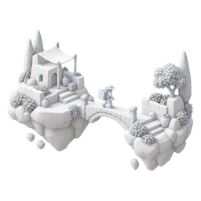

<picture>
  <source media="(prefers-color-scheme: dark)" srcset="docs/assets/readme/hero-dark.webp">
  
</picture>

<h1 align="center">meydan</h1>

<p align="center">
  <em>Meydan</em> is Turkish for the town square: the open place where people meet, talk and make plans.
</p>

<p align="center">
  
  
  
</p>

## Why

You post a plan in the WhatsApp group. Everyone says they'll come. The plan never happens.

Nobody owns the decision, there is no deadline, and when one person drops out the whole thing
quietly dies. meydan is for agents that fix exactly that: each person has an agent they talk to
over messaging, and one planner owns the shared decision: it proposes concrete options, closes
them by a rule, asks before committing anyone, and fills the spot when someone drops out.

Underneath sits the part every WhatsApp agent needs and nobody wants to rebuild: a runtime that
receives every message once and in order, keeps track of who is who, and makes sure every reply
arrives. That part is available today; the planner is on the [roadmap](#roadmap).

## Imagine you live here

<table>
  <tr>
    <td align="center" width="96"></td>
    <td>You live on this island. A small light follows you around and acts for you.</td>
    <td>your <b>personal agent</b></td>
  </tr>
  <tr>
    <td align="center" width="96"></td>
    <td>You decide how much it does on its own: <i>ask me first</i>, or <i>just handle it</i>.</td>
    <td><b>tunable</b><br><sub>planned</sub></td>
  </tr>
  <tr>
    <td align="center" width="96"></td>
    <td>Where you've named clearly what you want and you both agreed on it, it acts without being asked, the way you would think. You keep gardening that ground together, and it ripens with practice.</td>
    <td><b>proactive</b>, within what you agreed<br><sub>planned</sub></td>
  </tr>
  <tr>
    <td align="center" width="96"></td>
    <td>You talk to it by message, like to a friend.</td>
    <td>a <b>channel</b><br><sub>WhatsApp</sub></td>
  </tr>
  <tr>
    <td align="center" width="96"></td>
    <td>Every message reaches it once and in order. Every reply arrives.</td>
    <td>the <b>runtime</b></td>
  </tr>
  <tr>
    <td align="center" width="96"></td>
    <td>It thinks with a model. If one goes dark, the next is already lit.</td>
    <td><b>llm</b> with fallback</td>
  </tr>
  <tr>
    <td align="center" width="96"></td>
    <td>Your neighbors have lights too. When they need to agree on a time and place, one planner sets the table.</td>
    <td>the <b>planner</b><br><sub>planned</sub></td>
  </tr>
  <tr>
    <td align="center" width="96"></td>
    <td>The island is one community. Later, bridges to other islands.</td>
    <td>an <b>instance</b>, later <b>peers</b></td>
  </tr>
</table>

## In plain terms

meydan is a Python framework and a set of instance primitives for running **personal agents**
(one per person, acting on their behalf over a messaging channel such as WhatsApp) and
**planning agents** that coordinate people one-to-one and in groups: finding partners, forming
groups, agreeing on a time and place, filling a spot when someone drops out.

Each deployment is an **instance**: one community, its own data, its own VM. Instances are
designed to become peers in a network later (agent-to-agent, A2A-shaped messages).

> Status: early (v0.3.1). Only the pieces marked *available* below exist today. The rest is the
> plan, documented in [docs/architecture.md](docs/architecture.md).

**New in v0.2:** the channel and the runtime. meydan can now hold real WhatsApp
conversations, and you only write what the agent says back, `reply(turn)`.

**v0.2.1:** if the "typing…" indicator fails, the reply still goes out; errors that retrying
can't fix (a wrong token, a malformed request) are marked permanent right away.

**New in v0.3:** who is who. People, agents and organizations are **actors**; their addresses
(phone numbers, WhatsApp business-scoped user ids, email later) are **identities**, linked only
on evidence through append-only **claims** ([docs/identity.md](docs/identity.md)). A
conversation has its own id, so it survives a person hiding or sharing their number; replies
are one **turn** of one or more messages; `transcript()` reads a conversation on one clock.
Upgrading a v0.2 instance changes the tables: backfill old rows with
`meydan.runtime.identity.route` (one rule for old and new messages).

**v0.3.1:** presence. "Seen" about a second after a message arrives, then "typing…" when the reply
starts, refreshed while a slow reply is still being made; one setting (`presence="human" |
"instant" | "quiet"` or numbers), and a measurable timeline per turn ([docs/presence.md](docs/presence.md)).

<picture>
  <source media="(prefers-color-scheme: dark)" srcset="docs/assets/readme/flow-dark.svg">
  
</picture>

## What's in the box

<table>
  <tr>
    <td align="center" width="33%"><br><b><code>meydan.llm</code></b><br><sub>Models from spec strings, fallback chain, backpressure, one retry layer</sub><br><sub>✅ available</sub></td>
    <td align="center" width="33%"><br><b><code>meydan.clock</code></b><br><sub>One place that converts time and writes dates for people</sub><br><sub>✅ available</sub></td>
    <td align="center" width="33%"><br><b><code>meydan.tools</code></b><br><sub>Framework-agnostic tool contract, identity from the channel</sub><br><sub>✅ available</sub></td>
  </tr>
  <tr>
    <td align="center"><br><b><code>meydan.runtime</code></b><br><sub>Inbox → worker → outbox → sender, identities, on Postgres</sub><br><sub>✅ available · identities new in v0.3</sub></td>
    <td align="center"><br><b><code>meydan.channels.whatsapp</code></b><br><sub>WhatsApp Cloud API: webhooks in, messages out</sub><br><sub>✅ available · new in v0.2</sub></td>
    <td align="center"><br><b><code>templates/instance</code></b><br><sub>Compose stack, CI/CD, digest deploy with rollback</sub><br><sub>✅ available</sub></td>
  </tr>
  <tr>
    <td align="center"><br><b>planning</b><br><sub>Plan state machine, group consensus, matching, backfill</sub><br><sub>🧱 planned</sub></td>
    <td align="center"><br><b>peers</b><br><sub>Typed agent-to-agent messages, later between instances</sub><br><sub>🧱 planned</sub></td>
    <td align="center"><br><b>simulation</b><br><sub>Synthetic personas and scenarios to test agents first</sub><br><sub>🧱 planned</sub></td>
  </tr>
</table>

<details>
<summary>Module details</summary>

| Module | What it does | Status |
|---|---|---|
| `meydan.llm` | Provider-agnostic models from spec strings (`openrouter:…`, `vertex:…@location`), fallback chain, per-provider concurrency limit with bounded queue, one retry layer (Retry-After, jittered exponential backoff), timeouts | available (`meydan[llm]`) |
| `meydan.clock` | One place that converts time: instance zone, injectable clock, localized date text, date windows at their precision ("Aralık 2026"), a day calendar for agent context | available |
| `meydan.tools` | Framework-agnostic tool contract: `(ToolContext, **params) -> model`, identity from the channel, `ToolError` for business rules | available |
| `templates/instance` | Docker Compose stack (Postgres 18, app, Caddy), CI/CD workflow, digest-pinned deploy with health check and rollback, one-time GCP setup | available |
| `meydan.runtime` | Inbox (idempotent on message id) → identities (actors, addresses, evidence-based claims; [docs/identity.md](docs/identity.md)) → worker, one turn per conversation at a time (advisory lock, debounce, resequencing, poison-message guard) → transactional outbox → sender (per-conversation order, bubble pacing, jittered retries, dead letter, receipt correlation). Postgres 18 | available (`meydan[runtime]`) |
| `meydan.channels.whatsapp` | WhatsApp Cloud API: signature check, webhook parsing (text, buttons, interactive, receipts) routed by `phone_number_id`, sending text/templates from the number written to, typing indicator, retryable vs permanent errors | available (`meydan[runtime]`) |
| planning | Plan state machine, group consensus rules, matching, waitlist/backfill, reliability, consent | planned |
| peers | Typed agent-to-agent messages between roles and, later, between instances | planned |
| simulation | Synthetic personas and scenarios to evaluate agents before they meet people | planned |

</details>

## Install

meydan is consumed as a pinned git dependency:

```
uv add "meydan[llm,runtime] @ git+https://github.com/pehlivan-ai/meydan@v0.3.1"
```

For working on meydan and an instance at the same time, clone it next to the instance and point
the instance at it temporarily:

```
git clone git@github.com:pehlivan-ai/meydan.git ../meydan
uv add --editable ../meydan          # local co-development
# before merging the instance: back to a released tag
uv add "meydan[llm] @ git+https://github.com/pehlivan-ai/meydan@vX.Y.Z"
```

Docker and CI build from the instance repo alone, so don't symlink meydan into it.

## Quick look

```python
from meydan.clock import TR, Clock
from meydan.llm import LLM, LLMSettings

clock = Clock("Europe/Istanbul", TR)
clock.calendar(3)  # ['2026-10-26 26 Ekim Pazartesi', '2026-10-27 27 Ekim Salı', ...]

llm = LLM(
    LLMSettings(
        model="openrouter:deepseek/deepseek-v4.1-flash",
        fallback_models=["openrouter:qwen/qwen3.8-flash"],
    )
)
model = llm.get_model()  # hand this to a Pydantic AI Agent
```

`LLMSettings` also reads `MEYDAN_LLM_*` environment variables (and `OPENROUTER_API_KEY`).

## Runtime in an instance

```python
from meydan.channels.whatsapp import WhatsAppCloud, parse_messages, parse_statuses, verify_signature
from meydan.channels.base import Outbound
from meydan.runtime import Runtime, Turn, define_tables

runtime_tables = define_tables(Base.metadata)  # your Alembic migrates the meydan_* tables


async def reply(turn: Turn) -> list[Outbound]:  # your personal agent
    # turn.actor_id: who wrote, whichever address they used; key your domain data on it.
    return [Outbound.text_message(f"got: {turn.text}")]


runtime = Runtime(engine, runtime_tables, WhatsAppCloud(access_token), reply)

# webhook: verify, then store in the request's transaction and answer 200 right away
with engine.begin() as conn:
    runtime.receive(conn, parse_messages(payload), parse_statuses(payload))

# background (e.g. FastAPI lifespan): worker + sender loops
await runtime.run(stop_event)
```

## Setting up an instance

1. Copy `templates/instance/` into your app repo (rename `gitignore` to `.gitignore` or merge it).
2. Your app serves `GET /health` on port 8000 and has a `Dockerfile`.
3. Create a VM with Docker Engine + Compose, clone your repo to the instance directory, put
   secrets in `.env` there.
4. Run `scripts/gcp-setup.sh` once (see its header), then fill the `env:` block of
   `.github/workflows/ci-cd.yml` with its output.
5. Push to `main`: CI runs, the image is built once, pushed, and deployed by digest. If the new
   version isn't healthy, the VM rolls back to the previous digest.

Keep migrations backward compatible with the previous release, or rollback can't work.

## Roadmap

The order things are expected to land in, and what each builds on. A module moves into meydan
once real instances need it; the order may change with what they need.

| Next | What | Builds on |
|---|---|---|
| 1 | **Booking**: offering → slot → booking (`proposed → held → confirmed → done / no_show / cancelled`), freed time offered to a waitlist in order | identities, clock |
| 2 | **Proactive messages**: reminders and offers on a schedule, the 24-hour window with template fallback, consent per purpose | outbox, templates, clock |
| 3 | **Outcome ledger**: which conversation led to which booking, and who confirmed it | booking, conversations |
| 4 | **Second channel** (Telegram), **handoff** to a human and back, calendar adapters | channel contract, runtime |
| 5 | **Relations** between actors (acts for, member of), linking addresses on proof | identity claims |
| 6 | **Planner**: plan state machine, group consensus, matching, backfill, reliability | 1–5 |
| 7 | **Agreed ground**: per person and per topic, what the agent may do alone | proactive messages, planner |
| 8 | **Simulation**: synthetic personas and scenarios to test planning rules before people | booking, planner |
| 9 | **Peers**: typed agent-to-agent (A2A) messages, between roles and then between instances | relations, planner |

## Tell us

meydan is shaped by the people who use it. If you plan things with groups, or build agents on
WhatsApp, [open an issue](https://github.com/pehlivan-ai/meydan/issues/new) and tell us:

- which plans fall apart in your groups, and at which step;
- what you would expect from an agent on WhatsApp, and what it should never do on its own;
- what was hardest when you set up a WhatsApp agent yourself.

<details>
<summary>Türkçe</summary>

WhatsApp grubuna bir plan yazıyorsunuz, herkes "gelirim" diyor ama plan bir türlü
gerçekleşmiyor. meydan bunun için: herkesin mesajla konuştuğu bir kişisel agent'ı, ortak kararı
ise tek bir planlayıcı üstleniyor. Somut seçenekler sunuyor, kararı bir kurala göre kapatıyor,
kimseyi sormadan bir şeye bağlamıyor, biri vazgeçince yerini dolduruyor.

Bugün hazır olan kısım, her WhatsApp agent'ının ihtiyaç duyduğu altyapı: her mesajı bir kez ve
sırasıyla alan, kimin kim olduğunu takip eden ve her cevabın ulaşmasını sağlayan bir runtime.
Planlayıcı ve agent'lar arası (A2A) mesajlaşma yol haritasında. Fikirlerinizi ve
deneyimlerinizi [issue](https://github.com/pehlivan-ai/meydan/issues/new) olarak yazın.

</details>

## Development

```
uv sync --all-extras
uv run pytest
uv run ruff check . && uv run ruff format --check .
```

## License

Apache-2.0. See [LICENSE](LICENSE).
